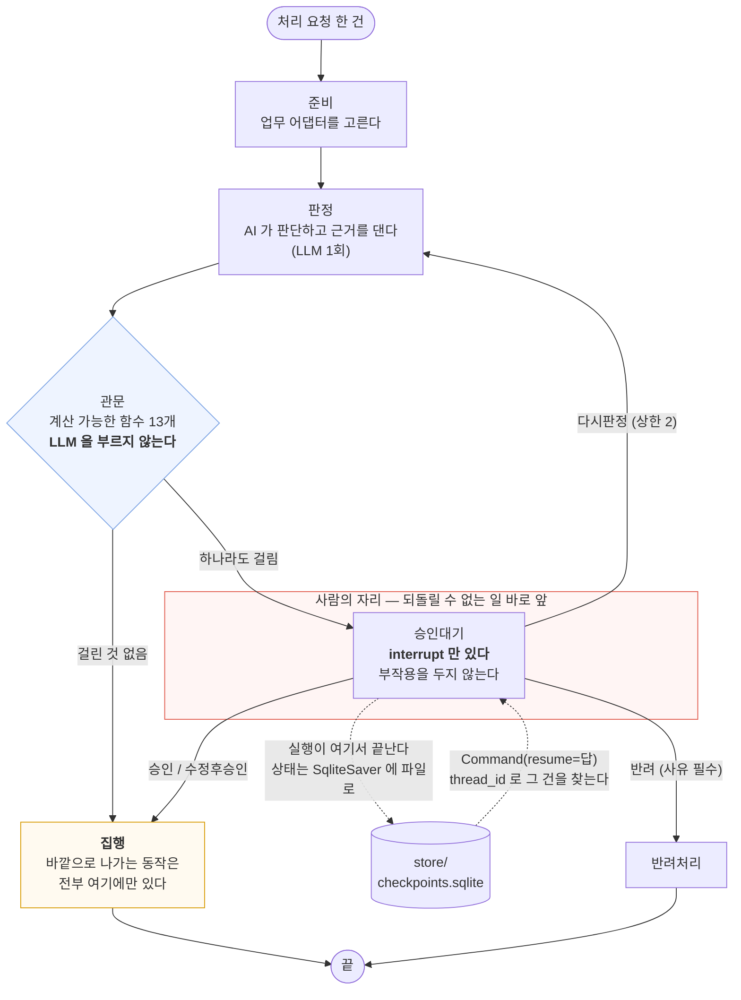
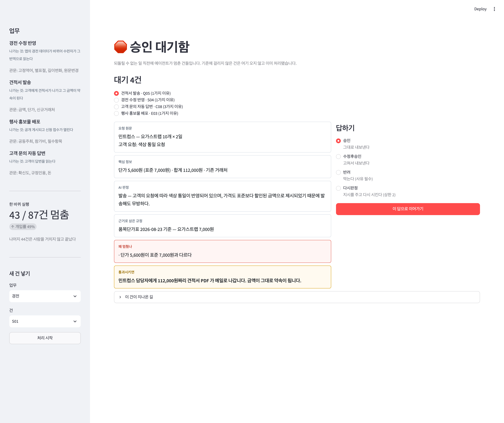

# 사람이 승인하는 에이전트 — 설계와 측정

모두의연구소 「에이전트 팀 꾸리기」 Main Quest 05 · 노드 5806 프로젝트 · 2026-09-28
실행 기록 전부는 [`output/runs.jsonl`](output/runs.jsonl) · [`output/bench.json`](output/bench.json) ·
[`output/summary.json`](output/summary.json) 에 있다.

---

## 1. 주제와 고른 이유

### 왜 넷인가

교안 1강의 표가 여섯 업무를 **한 틀**로 늘어놓는다 — 환불·답변·게시·문서수정·종결·일정.
전부 "결과가 바깥으로 나가고, 한 번 나가면 되돌리기 어렵고, 건마다 위험의 크기가 다르다".
그래서 **엔진을 하나 만들고 업무를 선언으로 얹는** 구조로 갔다. 업무 하나를 더하는 일은
`jobs.py` 에 다섯 줄짜리 블록 하나를 더하는 것이다.

넷으로 한 진짜 이유는 따로 있다. 교안 3강이 이렇게 경고한다.

> "금액 3만 원 초과 + 표현" 은 놓침과 헛멈춤이 둘 다 0입니다.
> **다만 5건짜리 예제라 0이 나온 것이고, 실제 업무에서는 둘을 동시에 0으로 만드는 기준이 거의 없습니다.**

업무 하나로는 이 말이 맞는지 확인할 수 없다. §5 에서 실제로 확인한다.

### 네 업무 — 무엇이 되돌릴 수 없는가

| 업무 | 바깥으로 나가는 것 | 되돌릴 수 없는 이유 |
|---|---|---|
| **① 경전 수정 반영** | 앱의 경전 데이터가 바뀐다 | 이미 그 번역으로 읽은 사람을 되돌릴 수 없다 |
| **② 견적서 발송** | 고객에게 견적서 PDF 가 나간다 | **그 금액이 그대로 약속이 된다** |
| **③ 행사 홍보물 배포** | 공개 게시되고 신청이 열린다 | 게시를 내려도 본 사람은 남는다 |
| **④ 고객 문의 자동 답변** | 고객이 답변을 읽는다 | 보낸 답은 주워 담을 수 없다 |

①을 고른 데는 사연이 있다. 소울매트에는 **"경전 검수·서류 접수·결제는 사람이 마무리한다"**
는 규칙이 이미 있다. 이 프로젝트는 그 규칙을 실습으로 지어낸 것이 아니라 **코드로 옮긴 것**이다.
④는 실제 고객 응대 봇이 있지만 개인정보 때문에 공개 저장소에 올릴 수 없어, **문의 20건을
전부 지어냈다.** 실제 고객 정보는 한 줄도 쓰지 않았다.

⛔ 실습에서 다룬 **환불 승인은 넣지 않았다**(주제에서 제외).

### 처리 대상 87건

| 업무 | 건수 | 어디서 왔나 | 사람이 봐야 하는 건 |
|---|---|---|---|
| 경전 | 27 | **LLM 이 실제로 제안했다.** 에캄 앱의 279절 중 120절을 읽히고 고칠 곳을 내게 했다 | 18건 (67%) |
| 견적 | 20 | 소울매트 `품목단가표.json`(2026-08-23)의 실제 단가로 구성 | 8건 (40%) |
| 행사 | 20 | 소울라이즈 실제 행사(오디시 워크숍·가을 요가 위켄드 등)로 구성 | 12건 (60%) |
| 문의 | 20 | 전부 지어냄 | 12건 (60%) |

`사람이_봐야하나` 라벨은 **기준을 재는 데만** 쓰고 에이전트에게는 보여 주지 않는다.
교안 3강의 표에 있는 '사람이 봐야 하나' 열과 같은 쓰임이다.

경전 27건의 라벨은 판정 모델(gpt-4o-mini)과 **다른 모델**(gpt-4.1)이 붙였고, 내가 27건을
전부 읽고 확인했다. 첫 라벨은 「순수의식 → 순수 의식」을 자동 통과로 놓았다 —
`puruṣa` 의 굳어진 역어를 건드리는 자리다. 프롬프트를 고쳐 다시 받아 잡았고,
**라벨도 틀린다**는 것을 여기 적어 둔다.

---

## 2. 파이프라인 구조도



**재개 경로가 점선 둘이다.** `승인대기` 에서 실행이 끝나고 상태가 파일에 남고,
`Command(resume=답)` 이 `thread_id` 로 그 건을 찾아 **같은 노드로 돌아온다.**

### 상태 (`graph.S`)

| 칸 | 리듀서 | 내용 |
|---|---|---|
| `업무` · `건` | — | 어느 어댑터로, 무엇을 |
| `판정` | — | AI 의 결정 · 근거 · 근거로 삼은 규정 |
| `멈춤사유` | — | 걸린 관문과 사유. **비어 있으면 자동으로 나간다** |
| `응답` | — | 담당자의 답 (답 · 사유 · 지시 · 수정값) |
| `결과` | — | 집행 결과 + `경로`("자동" / "사람(승인)" …) |
| `재판정` | — | 다시 판정한 횟수. 상한 2 |
| `켠관문` | — | 절제 실험용. 관문을 골라 켠다 |
| `log` | `operator.add` | 진행 기록. 데모의 "이 건이 지나온 길" |

### ⚠️ 이 구조에서 제일 중요한 한 줄

교안 2강이 경고한다 — **멈춘 단계는 재개할 때 처음부터 한 번 더 실행된다.**
체크포인트에 '몇 번째 줄'이 아니라 '단계 이름'만 적히기 때문이다.
멈추기 직전에 알림을 보내게 짜 두면 담당자가 답한 순간 같은 알림이 두 번 나간다.

그래서 **`승인대기` 노드 안에는 `interrupt` 말고 아무 부작용도 두지 않았고,
바깥으로 나가는 동작은 전부 `집행` 노드에만 두었다.**
말로 지키지 않고 [`tests.py`](tests.py) 가 매번 확인한다.

```
$ python tests.py
  ✓ t3_묻는단계는다시돈다   멈춘 단계(승인대기)는 재개 때 다시 실행된다 (2회) —
                          그래서 이 노드 안에 바깥으로 나가는 동작을 두면 두 번 나간다
  ✓ t4_집행은한번뿐        승인대기가 두 번 돌아도 집행은 정확히 한 번
  8/8 통과
```

**승인대기는 2번, 집행은 1번.** 이 두 숫자가 이 설계의 전부다.

### 체크포인터는 파일

`SqliteSaver` 로 `store/checkpoints.sqlite` 에 쌓는다. 교안 4강대로다 — 승인 대기는 초 단위가
아니고 담당자는 퇴근했을 수 있다. `InMemorySaver` 였으면 그 사이 프로그램이 꺼질 때
대기 건이 사라진다. `tests.py t7` 이 파일에 남는지 확인한다.

---

## 3. 승인 기준과 그 이유

관문 **13개**. 전부 **계산 가능한 함수**다 — LLM 을 부르지 않는다(`tests.py t8` 이 확인).
그래야 값을 바꿔 가며 비교할 수 있고(§5), 멈출지 말지를 정하는 자리에서 또 확률적인 판단을
하면 무엇 때문에 멈췄는지 설명할 수 없다.

### ① 경전 수정 반영

| 관문 | 조건 | 막으려는 위험 |
|---|---|---|
| **고정역어** | 바뀌는 구간에 `순수의식`(puruṣa) · `절대 신`(īśvara) · `독존`(kaivalya) · `마음의 작용`(citta-vṛtti) 가 걸림 | 앱 전체에서 이 말로 굳어 있다. **한 곳만 바뀌면 다른 화면과 어긋난다** |
| **별표절** | `star: true` (93/279절) | 홈·여덟가지 화면에 인용되는 절이다. 가장 많이 읽히는 자리 |
| **길이변화** | 한국어 길이가 15% 넘게 바뀜 | 다듬기가 아니라 재번역이라는 신호 |
| **원문변경** | 데바나가리·IAST 가 바뀜 | 기계 대조(`check-scripture.js`)를 다시 돌려야 한다 |

띄어쓰기만 달라져도 걸리게 공백을 지우고 견준다. 「순수의식 → 순수 의식」이 그래서 잡힌다.

**자동으로 나가는 건**: 가운뎃점을 쉼표로 바꾸거나(`들음·닿음·봄` → `들음, 닿음, 봄`),
`변화다 → 변화이다` 처럼 끝맺음만 다듬는 수정. 뜻이 그대로고 별표 절도 아니다.

### ② 견적서 발송

| 관문 | 조건 | 막으려는 위험 |
|---|---|---|
| **금액** | 합계 > 1,000,000원 | 틀린 금액이 그대로 약속이 된다 |
| **단가** | 단가 ≠ 품목단가표 표준가 | 할인을 임의로 준 것일 수 있다 |
| **신규거래처** | 과거 발행 이력 없음 | 거래 조건이 아직 안 정해졌다 |

경계값은 **초과**다. 딱 100만 원이면 안 걸린다 — 처음에 시험을 1,000,000으로 짜서 틀렸고,
지금은 `tests.py` 가 1,000,000 / 1,000,001 두 값을 못 박는다.

**자동으로 나가는 건**: 기존 거래처에 표준 단가로 나가는 소액 건.
12/20 건이 여기에 해당한다. 사람이 봐도 고칠 것이 없는 건들이다.

### ③ 행사 홍보물 배포

| 관문 | 조건 | 막으려는 위험 |
|---|---|---|
| **공동주최** | 외부 기관이 공동주최 | **상대 기관 사전승인 전에 나가면 안 된다** (오디시 워크숍은 인도문화원 사전승인이 실제 조건이다) |
| **참가비** | 참가비 > 0 | 돈이 오간다 |
| **필수항목** | 일시·정원이 비어 있음 | 신청이 열렸는데 정보가 없으면 문의가 쏟아진다 |

**자동으로 나가는 건**: 내부 무료 행사이고 일시·정원이 다 찬 것.

### ④ 고객 문의 자동 답변

| 관문 | 조건 | 막으려는 위험 |
|---|---|---|
| **확신도** | 분류 확신도 < 0.70 | 엉뚱한 분류로 엉뚱한 답이 나간다 |
| **규정인용** | 인용한 규정이 없음 | 근거 없이 지어낸 답 |
| **돈** | 분류가 환불·교환·하자·정산·취소·계약 | 돈이 걸린 답은 그대로 약속이 된다 |

**자동으로 나가는 건**: 배송 조회·영업시간·재입고 알림처럼 확신도가 높고 규정 인용이 붙은 단순 문의.

### 기준을 왜 두 종류 이상 두었나

교안의 환불 예제에서 **R3(31만 원)은 금액 때문에, R5(9천 원 단순 변심)는 사유 때문에** 걸린다.
금액 기준 하나로는 R5 가 빠져나간다. 네 업무 모두 **성격이 다른 기준을 두 개 이상** 섞은 이유다.
§5 의 표에서 기준 하나만 켰을 때 놓침이 얼마나 남는지 볼 수 있다.

### 운영 규칙 (정해 둔 것)

대기 건이 **3일**을 넘기면 자동 승인하지 않고 **자동 반려**하고 요청자에게 알린다.
자동 승인은 HITL 을 켜 둔 이유를 스스로 없애는 일이고, 방치하면 아무도 안 보는 목록이 된다.
(지금 코드에는 만료 처리기가 없다 — §7 에 남은 일로 적었다.)

---

## 4. 실행 결과

`python run_all.py` · 87건 한 바퀴 · 약 6분.

| 업무 | 전체 | 자동 | 멈춤 | 개입률 | 담당자가 어떻게 처리했나 |
|---|---|---|---|---|---|
| 경전 수정 반영 | 27 | 16 | 11 | 41% | 승인 10 · 반려 1 |
| 견적서 발송 | 20 | 12 | 8 | 40% | 승인 7 · **수정후승인 1** |
| 행사 홍보물 배포 | 20 | 8 | 12 | 60% | **반려 9** · 승인 3 |
| 고객 문의 자동 답변 | 20 | 8 | 12 | 60% | 승인 10 · 반려 2 |
| **합계** | **87** | **44** | **43** | **49%** | |

**44건은 사람을 한 번도 거치지 않고 끝났다.** 그게 이 구조를 쓰는 이유다.

멈춘 43건의 처리는 시연용 정책으로 돌렸다(`run_all.py` 의 `정책()`) — AI 판정이 '보류'면 반려,
경전의 고정 역어 위반은 무조건 반려, 견적의 표준가 미달은 표준가로 고쳐 '수정 후 승인'.
**실제 판단은 데모 화면에서 사람이 한다.** 정책을 코드로 적어 둔 것은 87건을 재현 가능하게
돌리기 위해서다.

읽을 만한 대목 둘.

- **행사에서 반려가 9건**으로 제일 많다. 일시·정원이 비어 있거나 참가비가 걸린 건들이고,
  AI 도 대부분 '보류'로 봤다. 이 업무는 자동화보다 **입력을 먼저 채우게 하는 것**이 맞다.
- **견적에서 '수정 후 승인'이 나왔다.** 표준가 7,000원짜리를 5,600원으로 낸 건을 표준가로
  고쳐서 보냈다. 승인/반려 둘뿐이었으면 이 건은 반려된 뒤 사람이 견적서를 직접 다시 만들었을 것이다.
  교안이 "실무에서 가장 많이 쓰인다"고 한 답이 실제로 쓰였다.

---

## 5. 멈춤 기준 검증

`python bench.py` — **LLM 없이 몇 초.** 관문을 전부 계산 가능한 함수로 짠 덕이다.
세 값은 교안 3강 그대로다: 개입률 · 놓침(봤어야 하는데 자동으로 나감) · 헛멈춤(볼 필요 없는데 옴).

### ① 경전 — 놓침이 남는다

| 기준 | 개입률 | 놓침 | 헛멈춤 |
|---|---|---|---|
| 기준 없음 (전부 자동) | 0% | **18** | 0 |
| 고정역어 하나만 | 4% | 17 | 0 |
| 별표절 하나만 | 37% | 9 | 1 |
| 길이변화 하나만 | 4% | 17 | 0 |
| 원문변경 하나만 | 0% | 18 | 0 |
| 고정역어+별표절 | 41% | 8 | 1 |
| **전체 관문 (기본)** | **41%** | **8** | **1** |
| 전부 멈춤 | 100% | 0 | 9 |

### ②③④ — 놓침·헛멈춤이 둘 다 0

| 업무 | 기준 없음 | 기준 하나만 (최선) | **전체 관문** | 전부 멈춤 |
|---|---|---|---|---|
| 견적 | 0% / 놓침 8 | 신규거래처 30% / 놓침 2 | **40% / 0 / 0** | 100% / 헛멈춤 12 |
| 행사 | 0% / 놓침 12 | 참가비 30% / 놓침 6 | **60% / 0 / 0** | 100% / 헛멈춤 8 |
| 문의 | 0% / 놓침 12 | 돈 55% / 놓침 1 | **60% / 0 / 0** | 100% / 헛멈춤 8 |

### 이 표를 읽는 법 — **0을 자랑으로 쓰면 안 된다**

②③④ 에서 둘 다 0이 나온 것은 기준이 훌륭해서가 아니다.
**내가 그 위험만 골라 넣어 데이터를 만들었기 때문이다.** 견적 20건의 위험은 금액·단가·신규거래처
셋뿐이고, 관문도 그 셋이다. 정답과 기준이 같은 것을 보고 있으니 0이 나올 수밖에 없다.
교안이 "5건짜리 예제라 0이 나온 것"이라고 한 바로 그 상황이고, 내 데이터도 다르지 않다.

**믿을 만한 것은 경전 쪽 숫자다.** 경전 27건의 라벨은 내가 아니라 **다른 모델이 독립적으로**
붙였고, 판정 기준도 달랐다 — 관문은 *계산 가능한 겉모습*(고정역어·별표·길이)을 보고,
라벨은 *뜻이 달라지는가*를 본다. 그래서 갈라진다.

**놓친 8건 (30%)** — 전부 겉모습으로는 잡을 수 없는 것들이다.

| 건 | 수정 | 왜 사람이 봐야 했나 |
|---|---|---|
| S06 | 버린다 → 버려진다 | 능동/수동이 바뀌어 **문장의 주체가 달라진다** |
| S21 | 스러지고 → 사라지고 | 점차 없어짐 vs 갑작스러운 소멸 — 뉘앙스가 다르다 |
| S23 | 견주면 바깥 가지다 → 비하면 바깥에 있다 | 주체와 위치가 달라진다 |
| S24 | 본바탕이 차오름 → 본바탕의 차오름 | 조사 하나로 주체와 소유가 갈린다 |
| S03·S09·S10·S17 | 연결어미·유의어 교체 | 시제·양태·굳어진 역어 문제 |

**길이도 안 바뀌고 고정 역어도 아니고 별표 절도 아니다.** 계산 가능한 관문으로는 못 잡는다.
이게 이 프로젝트에서 가장 정직한 숫자다 — **기준을 잘 짜도 30%는 샌다.**

**헛멈춘 1건 (S25)** — `III.51` 에 "그러면"을 더하는 수정이다. 라벨은 "논리 연결을 명확히 할 뿐"
이라 자동 통과로 봤는데, 별표 절이라 관문이 잡았다. 이건 **일부러 감수한 헛멈춤**이다.
가장 많이 읽히는 93절은 사람이 한 번 보는 값이 있다고 봤다.

**한 번도 안 걸린 관문이 있다** — `원문변경`(0/27). LLM 이 한국어만 고치자고 했기 때문이다.
지우지 않고 뒀다. 데바나가리를 건드리는 제안이 언젠가 오면 그때 걸려야 한다.

### 기준 하나로는 안 된다

표에서 제일 분명한 줄은 **"기준 하나만"** 행들이다. 경전에서 고정역어 하나만 켜면 개입률 4%에
놓침이 17건 남는다. 견적에서 금액 하나만 켜면 놓침 6건이 남는다. 교안의 R5(9천 원 단순 변심)가
금액 기준을 빠져나가는 것과 같은 일이 네 업무에서 모두 일어난다.

---

## 6. 데모 화면 설계

```bash
.venv/bin/streamlit run app.py
```



목표는 하나다 — **담당자가 10초 안에 판단한다.** 그래서 무엇을 넣을지보다 **무엇을 뺄지**를 먼저 정했다.

### 넣은 것 — 다섯 칸 + 두 칸

| 칸 | 왜 |
|---|---|
| 요청 원문 | 판단의 출발점. 경전은 「지금 → 고치면」을 두 줄로 나란히 |
| 핵심 정보 | 시스템을 따로 열지 않게 하는 칸. 견적은 단가·표준가·합계·거래처 이력을 한 줄에 |
| AI 판정 | 결정과 근거 |
| **근거로 삼은 규정** | AI 가 무엇을 읽고 그렇게 판단했는지. 이게 없으면 담당자가 규정 문서를 따로 찾는다 |
| **왜 멈췄나** (빨강) | 걸린 관문의 사유를 그대로. "무엇이 위험하다고 본 건지"를 먼저 안다 |
| **통과시키면** (노랑·굵게) | 가장 중요한 칸 |

마지막 칸을 **색과 굵기로 따로 떼어** 놓았다.
*"민트컴스 담당자에게 112,000원짜리 견적서 PDF 가 메일로 나갑니다. 금액이 그대로 약속이 됩니다."*
— 이 문장을 읽고 나면 승인 버튼의 무게가 달라진다. 무슨 일이 일어나는지 모른 채 누르는 승인이
가장 위험하다.

### 뺀 것

- **지표·차트를 본문에서 뺐다.** 개입률 같은 숫자는 사이드바 구석에 한 줄로만 둔다.
  담당자가 이 화면에서 할 일은 한 건을 판단하는 것이지 통계를 보는 것이 아니다.
- **원문 전체를 안 보여 준다.** 경전은 바뀌는 두 줄만, 견적은 금액 줄만. 전문을 붙이면
  10초가 안 된다. 대신 「이 건이 지나온 길」을 접어 두어 필요할 때만 펼치게 했다.
- **`thread_id` 같은 내부 값을 접었다.** 접힌 칸 안에만 둔다.
- **자동으로 끝난 44건을 목록에 안 띄운다.** 대기함에는 **답이 필요한 건만** 있어야 한다.
  자동 처리 건까지 섞이면 대기함이 로그가 되고, 그러면 아무도 안 본다.

### 응답 넷

각 답 밑에 **그 답이 무슨 뜻인지 한 줄**을 붙였다(`그대로 내보낸다` / `고쳐서 내보낸다` /
`막는다 (사유 필수)` / `지시를 주고 다시 시킨다 (상한 2)`).

- **반려는 사유를 안 적으면 버튼이 눌리지 않는다.** 나중에 왜 막았는지 추적할 수 있어야 하고,
  그게 기준을 고칠 재료가 된다.
- **수정 후 승인은 업무마다 고치는 칸이 다르다.** 견적은 합계, 경전은 번역문, 문의는 답변 본문.
  행사는 고칠 칸이 없어 그렇게 적어 두었다.
- **다시 판정은 상한 2.** 넘으면 반려로 떨어진다.

### 사이드바

네 업무의 **"나가는 것"과 관문 목록**을 항상 띄워 둔다. 담당자가 "이 업무는 무엇이 위험해서
멈추는 곳인지"를 늘 보게 하려는 것이다. 아래에 한 바퀴 실행 결과(87건 중 43건 멈춤, 개입률 49%)와
새 건을 넣는 칸을 둔다.

> 캡처는 `docs/capture.py` 가 크롬을 디버깅 포트로 띄우고 **「통과시키면」 칸이 실제로 그려진 것을
> 확인한 뒤** 찍는다. 헤드리스 크롬의 `--screenshot` 은 Streamlit 에 못 쓴다(WebSocket 으로
> 그리는데 가상 시간만 돌아 로딩 뼈대가 찍힌다).

---

## 7. 회고

### 가장 공들인 부분

**① 재실행 함정을 말이 아니라 시험으로 막은 것.**
교안이 "멈춘 단계는 처음부터 다시 실행된다"고 경고하는데, 이건 읽고 고개를 끄덕여도
코드가 커지면 잊는다. `승인대기` 노드를 `interrupt` 한 줄만 남기고 비워 두고,
`tests.py` 가 **승인대기 2회 / 집행 1회**를 매번 확인하게 했다. 이 두 숫자가 깨지면
어디선가 부작용이 묻는 단계 안으로 들어온 것이다.

**② 관문에서 LLM 을 뺀 것.**
멈출지 말지를 정하는 자리에서 또 확률적인 판단을 하면, 왜 멈췄는지 설명할 수 없고
기준을 바꿔 가며 비교할 수도 없다. 13개 관문을 전부 순수 함수로 두었더니
`bench.py` 가 **LLM 없이 몇 초에** 돌고, `tests.py t8` 이 관문이 LLM 을 안 부르는지 확인한다.

**③ 0을 자랑으로 쓰지 않은 것.**
②③④ 에서 놓침·헛멈춤이 둘 다 0이 나왔을 때 그대로 적을 수도 있었다. 그런데 그건
내가 그 위험만 넣어 데이터를 만들었기 때문이다. 라벨을 독립적으로 붙인 경전에서
**놓침 8건(30%)** 이 남은 것이 진짜 숫자다. 교안의 경고가 내 데이터에서 그대로 재현됐다.

### 앞으로 보완하고 싶은 점

**하나만 고른다면 — 놓친 8건을 잡는 관문.**
지금 관문은 겉모습(고정역어·별표·길이·원문)만 본다. 놓친 8건은 전부 *뜻*이 바뀌는 수정이다.
판정 모델을 관문에 쓰면 "왜 멈췄는지 설명할 수 없다"는 문제가 생기므로, 그 사이를 가는 방법을
생각하고 있다 — **조사·어미·태(態)를 형태소로 견주는 계산 가능한 검사**. '버린다/버려진다'의
피동 접미사, '이/의'의 격조사 교체는 규칙으로 잡힌다. 잡히는 만큼 놓침이 줄어드는지 `bench.py`
로 바로 잴 수 있다.

그 밖에.

- **3일 만료 처리기가 없다.** 운영 규칙은 §3 에 정했는데 코드가 없다. 대기 건의 나이를
  체크포인트 시각에서 재서 자동 반려하는 배치가 필요하다.
- **데이터가 얇다.** 87건이고 업무당 20~27건이라 기준 하나를 바꿨을 때의 차이가 1~2건 단위로
  움직인다. 실제 운영 로그로 몇백 건을 모아 다시 재야 한다.
- **②③④ 의 라벨을 독립적으로 다시 붙여야 한다.** 지금은 내가 만들면서 정한 라벨이라
  기준과 같은 것을 보고 있다. 경전처럼 다른 모델이나 사람이 따로 붙이면 이쪽에서도
  놓침이 드러날 것이다.
- **헛멈춤을 줄이는 쪽은 아직 손대지 않았다.** 개입률 49%는 담당자가 절반을 본다는 뜻이라
  실무에서는 높다. 다만 **놓침을 늘리지 않고 헛멈춤만 줄이는** 방법을 찾기 전에는
  기준을 헐겁게 하지 않는 편이 맞다고 봤다.
- 문의 업무의 확신도는 지금 데이터에 박혀 있다. 실제 분류기를 붙이면 값이 흔들릴 텐데,
  그때 0.70 이라는 문턱이 맞는지 다시 재야 한다.
